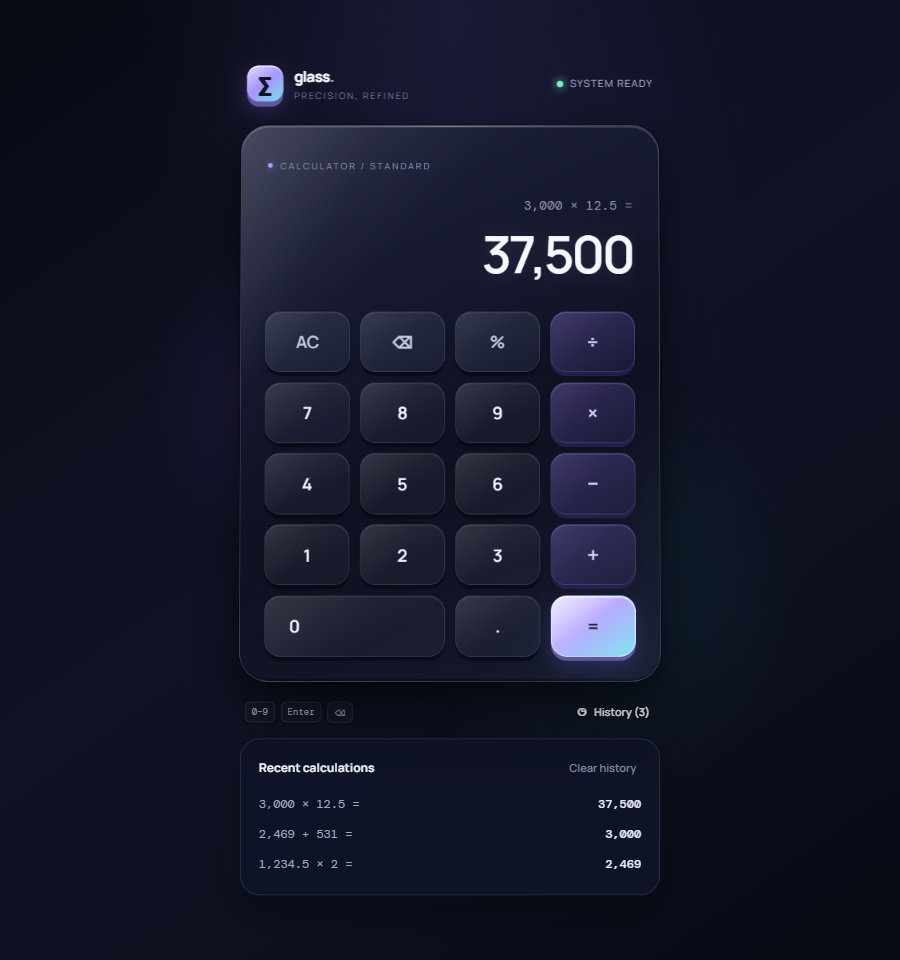

<div align="center">

# glass. — Calculator

A glassmorphism calculator built with **React 19**, **TypeScript** and **Vite**.

**[Live demo →](https://senpaijoeru05.github.io/glassmorphism-calculator/)**



</div>

## Features

- **Glassmorphism UI.** Layered translucent panels, soft inner highlights, breathing background light and a subtle 3D parallax tilt that follows the pointer.
- **Chained calculations.** `2 + 3 × 4` evaluates left to right like a desk calculator. Pressing a second operator swaps it.
- **Live formatting.** Thousands are grouped while you type (`1,234.50`), and very large or tiny results switch to exponent notation.
- **History.** The last 8 results are saved in `localStorage`. Click one to reuse it.
- **Full keyboard support.** Digits, `+ - * /`, `Enter`, `Backspace`, `Esc` and `%`. The matching on-screen key lights up as you type.
- **Accessible.** Real `<button>`s with labels, a live region for the result, visible focus rings, and no motion when the OS asks for reduced motion.

## Tech

| | |
|---|---|
| UI | React 19, plain CSS (one stylesheet per component) |
| Language | TypeScript (strict) |
| Build | Vite |
| Tests | Vitest |
| Lint | oxlint |
| CI / Deploy | GitHub Actions → GitHub Pages |

## How it's built

All calculator behaviour lives in a **pure reducer** ([`src/lib/calculator.ts`](src/lib/calculator.ts)), separate from React. Components only render state and dispatch actions. That keeps the logic easy to test without a browser. Every rule (chaining, operator swapping, divide-by-zero, percent, backspace, history) has its own unit test in [`calculator.test.ts`](src/lib/calculator.test.ts).

```
src/
├── lib/            calculator reducer, number formatting, history storage (+ tests)
├── hooks/          useKeyboard (key → action), useTilt (pointer parallax)
└── components/     Topbar, Calculator, Display, Keypad, HistoryPanel, Toast
```

## Run it locally

```bash
npm install
npm run dev        # start the dev server
npm test           # run the unit tests
npm run lint       # lint
npm run build      # type-check and build for production
```

## Origin

This started as a single self-contained HTML file. I rebuilt it in React with TypeScript to separate the logic from the view, add tests, and make it easy to extend.
